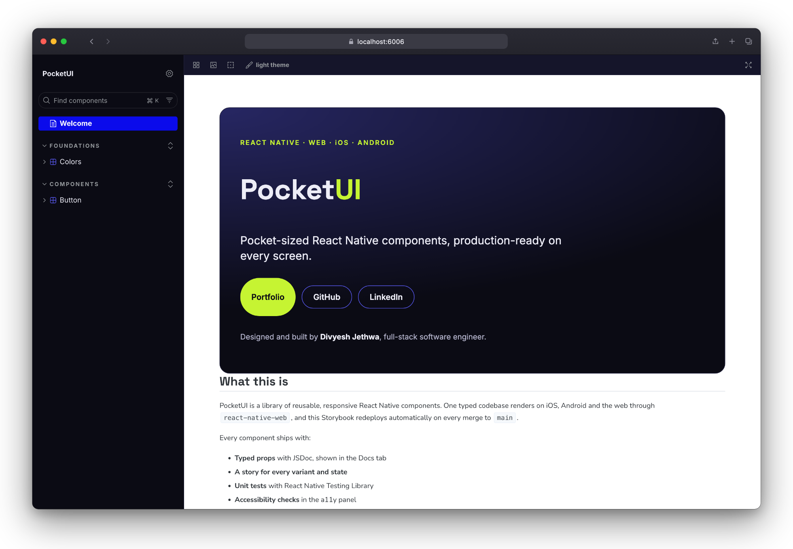
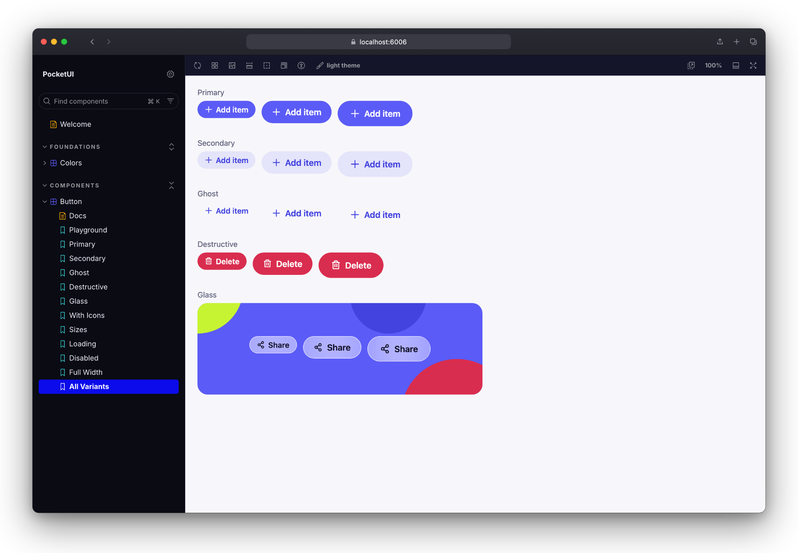
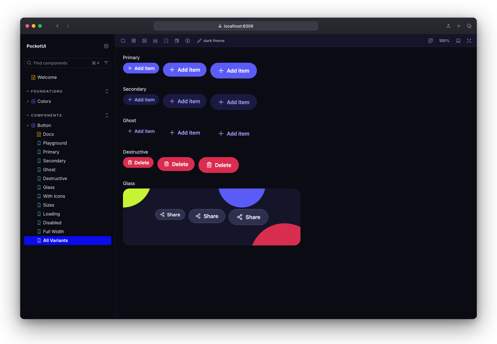
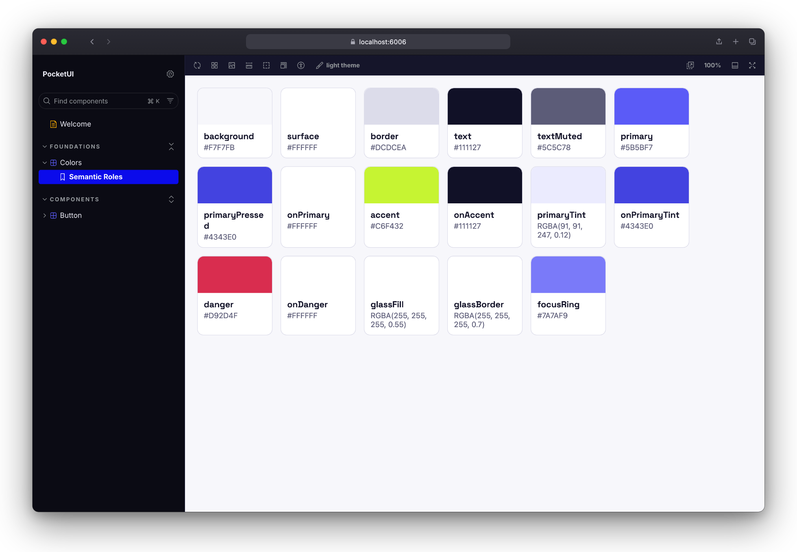
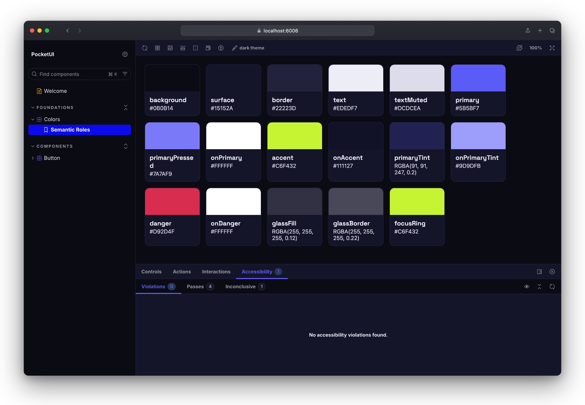
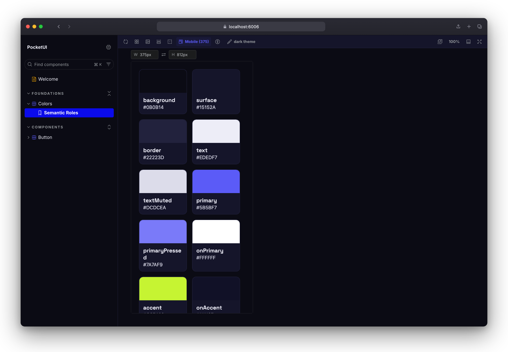

# PocketUI

**Pocket-sized React Native components, production-ready on every screen.**

PocketUI is a library of reusable, responsive React Native components. One TypeScript codebase renders on iOS, Android and the web, and every component is documented in a live Storybook that redeploys automatically on each merge to `main`.

> **Live Storybook:** coming soon (Netlify)
> **Status:** first component (Button) shipped — components land roughly daily.

## Screenshots

<p align="center">
  
</p>

<table>
  <tr>
    <td width="50%"></td>
    <td width="50%"></td>
  </tr>
  <tr>
    <td align="center"><sub><b>Button</b> — primary, tinted, plain, destructive, glass</sub></td>
    <td align="center"><sub><b>Dark mode</b> — frosted glass over colour</sub></td>
  </tr>
  <tr>
    <td width="50%"></td>
    <td width="50%"></td>
  </tr>
  <tr>
    <td align="center"><sub><b>Light theme</b> — every semantic colour role</sub></td>
    <td align="center"><sub><b>Dark theme</b> — a11y panel: 0 violations</sub></td>
  </tr>
  <tr>
    <td width="50%"></td>
    <td width="50%" valign="middle">
      <b>Responsive by default.</b> The viewport toolbar previews every story at
      Mobile (375), Tablet (768) and Desktop (1280), in light and dark.
    </td>
  </tr>
</table>

## Why this repo exists

PocketUI is a personal project where I build front-end systems the way I would in production: typed component APIs, a token-driven theme, tests for every component, and CI/CD that keeps `main` always deployable.

## Native iOS feel

Components follow Apple's Human Interface Guidelines so they feel at home on iPhone, while still working on Android and the web:

- **Spring press feedback**: a subtle scale and dim on press (Reanimated), instead of a web-style hover or Android ripple
- **Haptics**: a light tap on press via `expo-haptics` (iOS and Android; off on web)
- **System font**: SF Pro on Apple devices, Roboto on Android; 17pt body text like iOS
- **44pt touch targets**, capsule buttons, and a translucent **glass** material inspired by iOS
- **Respects user settings**: Reduce Motion, Dynamic Type text scaling, and VoiceOver/TalkBack labels and states

## Stack

| Area       | Choice                                                         |
| ---------- | -------------------------------------------------------------- |
| Language   | TypeScript (strict)                                            |
| Components | React Native + `react-native-web`, on Expo SDK 58              |
| Docs       | Storybook (`@storybook/react-native-web-vite`), autodocs, a11y |
| Styling    | Design tokens in `src/theme` — light and dark from day one     |
| Motion     | `react-native-reanimated` springs, `expo-haptics`              |
| Icons      | [Phosphor](https://phosphoricons.com) (any icon element works) |
| Testing    | Jest + React Native Testing Library                            |
| Quality    | ESLint, Prettier, `tsc --noEmit`, enforced in CI               |
| CI/CD      | GitHub Actions → Netlify                                       |

## Theme: Electric Midnight

| Token      | Value                                                         |
| ---------- | ------------------------------------------------------------- |
| Primary    | `#5B5BF7` indigo                                              |
| Accent     | `#C6F432` neon lime                                           |
| Background | `#F7F7FB` light / `#0B0B14` dark                              |
| Text       | `#111127` light / `#EDEDF7` dark                              |
| Radius     | 12px, pill buttons                                            |
| Danger     | `#D92D4F` (4.7:1 with white text)                             |
| Type       | Space Grotesk (headings), system font (body: SF Pro / Roboto) |

Components never hard-code colours or spacing; they read semantic roles from `useTheme()`.

## How to use

### Browse the Storybook

1. Run `npm run storybook` and open <http://localhost:6006>.
2. Start at **Welcome**, then pick a story from the sidebar.
3. Use the toolbar to switch **light / dark** theme and the **viewport** (mobile, tablet, desktop).
4. Open the **Docs** tab for props and usage, and the **Accessibility** panel for a11y checks.

### Use PocketUI in a React Native app

Wrap your app once in `ThemeProvider`, then use components and tokens from the same entry point.

```tsx
import { ArrowRight, Trash } from 'phosphor-react-native';
import { Button, ThemeProvider } from './src'; // the package entry point once published

export default function Checkout() {
  return (
    <ThemeProvider>
      <Button rightIcon={<ArrowRight />} onPress={pay} fullWidth size="lg">
        Pay now
      </Button>
      <Button variant="secondary" onPress={saveForLater}>
        Save for later
      </Button>
      <Button variant="destructive" leftIcon={<Trash />} loading={isDeleting} onPress={remove}>
        Remove
      </Button>
    </ThemeProvider>
  );
}
```

| Prop                     | Values                                                    | Default   |
| ------------------------ | --------------------------------------------------------- | --------- |
| `variant`                | `primary` `secondary` `ghost` `destructive` `glass`       | `primary` |
| `size`                   | `sm` (34pt, 44pt touch area) `md` (44pt) `lg` (50pt)      | `md`      |
| `loading` / `disabled`   | Spinner and busy state / dimmed; both block presses       | `false`   |
| `leftIcon` / `rightIcon` | Any icon element; colour, size and weight are set for you | —         |
| `fullWidth`              | Stretch to the container width                            | `false`   |
| `haptics`                | Light haptic tap on press (native only)                   | `true`    |

Build your own components on the same tokens with `useTheme()`:

```tsx
import { Text, View } from 'react-native';
import { ThemeProvider, useTheme } from './src'; // the package entry point once published

function Card() {
  const theme = useTheme();
  return (
    <View
      style={{
        backgroundColor: theme.colors.surface,
        borderRadius: theme.radii.md,
        padding: theme.spacing.lg,
      }}
    >
      <Text style={{ color: theme.colors.text, fontSize: theme.typography.sizes.lg }}>
        Hello from PocketUI
      </Text>
    </View>
  );
}

export default function App() {
  return (
    <ThemeProvider /* scheme="dark" to force a theme; defaults to the device setting */>
      <Card />
    </ThemeProvider>
  );
}
```

### Regenerate the screenshots

```bash
npm run screenshots   # macOS + Google Chrome; writes docs/screenshots/*.png
```

The script builds the static Storybook, captures each view with headless Chrome and frames it in a macOS browser window (`scripts/screenshots/frame.html`).

## Project structure

```
src/
  components/       # one folder per component: Component.tsx, .stories.tsx, .test.tsx, index.ts
  theme/            # tokens, light/dark themes, ThemeProvider + useTheme
  hooks/            # shared hooks (e.g. keyboard-only focus rings)
  platform/         # native vs web implementations (haptics, blur)
  index.ts          # public exports
.storybook/         # Storybook config
.github/workflows/  # CI and deploy pipelines
scripts/            # screenshot capture, component generator
docs/screenshots/   # README images
```

## Getting started

Requires Node.js 24 (see `.nvmrc`).

```bash
npm install
npm run storybook    # Storybook at http://localhost:6006
npm run build-storybook  # static build in storybook-static/
npm run web          # run the Expo app in the browser
npm test             # Jest + React Native Testing Library
npm run lint         # ESLint
npm run typecheck    # TypeScript, no emit
npm run format       # Prettier
npm run screenshots  # regenerate README screenshots
```

## Roadmap

1. Repo foundation — TypeScript, linting, theme tokens ✅
2. Storybook with docs, viewport, a11y and theme switcher ✅
3. Button — the first component ✅
4. CI on every pull request
5. Automatic deployment to Netlify
6. Component generator and daily workflow

## Licence

[MIT](./LICENSE) © Divyesh Jethwa
